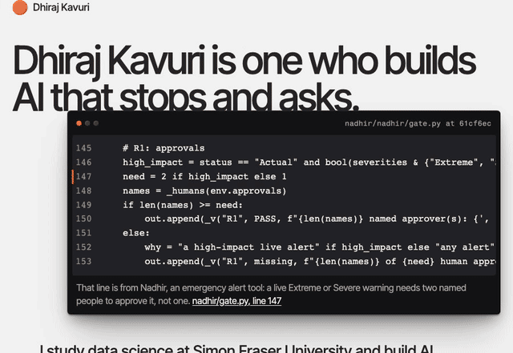

# Dhiraj Kavuri is one who builds AI you can check, line by line

My portfolio. Each featured product has one thing its AI is not allowed to decide, and the site shows the line of code that stops it, pinned to a commit.

Live: https://dhirajkavuri.isonewho.codes



Try it in 30 seconds:
1. Open the link. The first three products are already open.
2. Read one question and my answer, then look at the highlighted lines under it.
3. Click the file name above the code. GitHub opens at the same lines and commit.

## How it's built

- `content/` holds everything the site says: `site.json` (copy), `featured.json` (the seven products, their questions, answers and pinned code ranges), `products.json` (everything else), `facts.json` (every number in the copy, with its source).
- `content/code/` holds the source files at their pinned commits. A test downloads each one from GitHub and fails if the copy here differs.
- `scripts/gif.mjs` and `scripts/og.mjs` record the GIF above and the link preview from the real page.
- `build.mjs` turns the content into plain HTML with inline CSS in `dist/`. No framework and no web fonts. The only script is a few hundred bytes inline, for the ONEWHO application-link note.

```bash
npm install
npm run build
npm run serve        # http://localhost:4321
./check.sh           # content tests, browser tests at phone and laptop width, Lighthouse, link check
```

Deployed on Vercel and served through ONEWHO.
